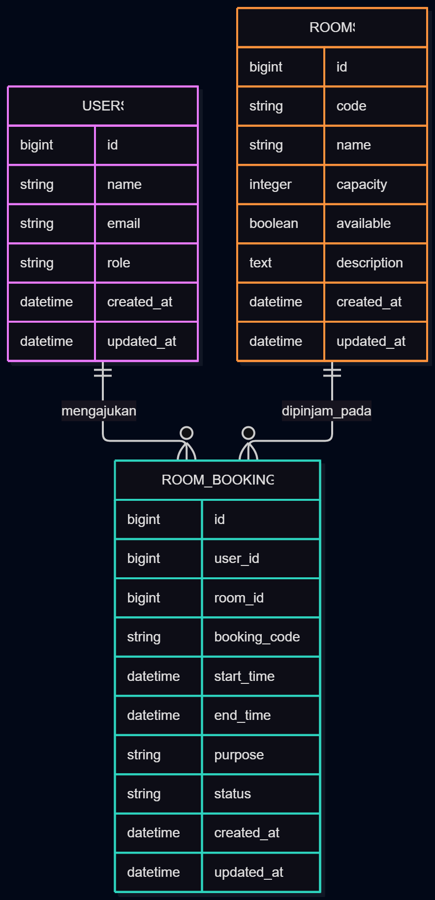

# TP7 — ERD dan Migration Domain Capstone

## 1. Entity Relationship Diagram (ERD)

## 2. Primary Key, Foreign Key, dan Kardinalitas Relasi

| Entitas | Primary Key (PK) | Foreign Key (FK) | Kardinalitas & Penjelasan Relasi |
| :--- | :--- | :--- | :--- |
| **`users`** | `id` (`bigint`) | — | **1 : N terhadap `room_bookings`**. Satu pengguna dapat mengajukan banyak peminjaman ruangan (`has_many :room_bookings`), sedangkan satu data peminjaman hanya dimiliki oleh satu pengguna (`belongs_to :user`). |
| **`rooms`** | `id` (`bigint`) | — | **1 : N terhadap `room_bookings`**. Satu ruangan dapat digunakan dalam banyak jadwal peminjaman (`has_many :room_bookings`), sedangkan satu data peminjaman hanya merujuk pada satu ruangan (`belongs_to :room`). |
| **`room_bookings`** | `id` (`bigint`) | `user_id` → `users(id)` `room_id` → `rooms(id)` | **Entitas penghubung (associative entity)** untuk relasi **M : N (*Many-to-Many*)** antara `users` dan `rooms` (`has_many :through`), sekaligus menyimpan atribut transaksi (`booking_code`, `start_time`, `end_time`, `purpose`, `status`). |

### Pemilihan Association Active Record
- **`User`**: `has_many :room_bookings, dependent: :destroy` dan `has_many :rooms, through: :room_bookings` — jika akun pengguna dihapus, riwayat peminjamannya ikut dibersihkan agar tidak meninggalkan *orphan record*.
- **`Room`**: `has_many :room_bookings, dependent: :restrict_with_error` dan `has_many :users, through: :room_bookings` — ruangan tidak boleh dihapus jika masih memiliki riwayat/jadwal peminjaman demi menjaga jejak audit.
- **`RoomBooking`**: `belongs_to :user` dan `belongs_to :room` — memvalidasi keberadaan parent secara otomatis sebelum penyimpanan.